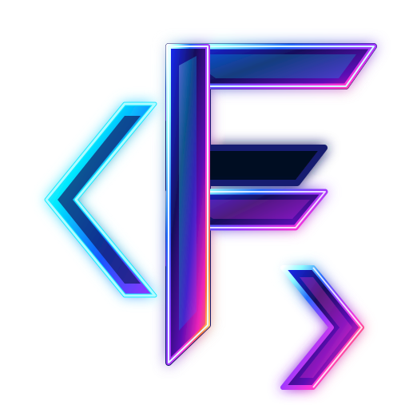

<!-- FORGE — AI Harness for software engineering -->

<p align="center">
  
</p>

<h1 align="center">FORGE — The AI Harness</h1>

<p align="center">
  <strong>An open-source AI engineering harness for orchestrating agents, understanding codebases, reviewing changes, and verifying results.</strong>
</p>

<p align="center">
  <a href="https://github.com/forge-workbench" style="text-decoration:none"></a>
  <a href="https://forge-ecc.vercel.app/"></a>
  <a href="https://forge-ecc.vercel.app/api/github/install" style="text-decoration:none"></a>
  <a href="LICENSE"></a>
</p>

<p align="center">
  <a href="https://github.com/ansh44233/FORGE-ECC"></a>
  <a href="https://github.com/ansh44233/FORGE-ECC/forks"></a>
  <a href="https://github.com/ansh44233/FORGE-ECC/graphs/contributors"></a>
  <a href="https://github.com/ansh44233/FORGE-ECC/commits/main"></a>
  <a href="https://github.com/ansh44233/FORGE-ECC/actions/workflows/ci.yml"></a>
  <a href="https://github.com/ansh44233/FORGE-ECC/releases"></a>
</p>

<p align="center">
  
  
  
  
  
  
  
</p>

<p align="center">
  <a href="https://www.star-history.com/ansh44233/FORGE-ECC">
    
  </a>
  <a href="https://www.star-history.com/ansh44233/FORGE-ECC">
    
  </a>
</p>

<p align="center">
  <sub>These are live-status placeholders until Star History publishes a trending record and global rank for FORGE. They will be replaced with Star History's live badge images once those records are available.</sub>
</p>

<p align="center">
  <strong>Built and maintained by <a href="https://github.com/forge-workbench">FORGE WORKBENCH</a></strong>
</p>

<p align="center">
  <a href="#quick-start">Quick start</a> ·
  <a href="#features">Features</a> ·
  <a href="#dashboard">Dashboard</a> ·
  <a href="#ai-providers">AI providers</a> ·
  <a href="#integrations">Integrations</a> ·
  <a href="#security-model">Security</a> ·
  <a href="#roadmap">Roadmap</a>
</p>

---

> [!NOTE]
> **FORGE v1.0.0 — AI harness foundation.** The local CLI, local dashboard, agent orchestration, MCP server, provider adapters, GitHub Action and GitHub App installation/authentication foundation are available. The GitHub App does not yet perform hosted repository scans or create pull requests. See [Current capabilities and boundaries](#current-capabilities-and-boundaries).

## What is FORGE?

**FORGE (FORGE Engineering Workbench)** is a local-first AI engineering harness for developers who want more than a chat window pointed at a repository.

It brings codebase understanding, specialist-agent workflows, engineering review, human approval, verification, experiment tracking and a live local dashboard into one inspectable system.

FORGE is built around a simple engineering loop:

```text
inspect → understand → plan → propose → review → approve → verify → learn
```

The goal is not to let an agent silently take over a project. The goal is to make AI-assisted engineering **observable, reviewable and evidence-driven**: proposals remain proposals until a person approves the next step.

### At a glance

| | FORGE provides |
|---|---|
| **Codebase intelligence** | Project inventory, code search, architecture maps, dependency analysis and change impact |
| **Agent harness** | Specialist roles, skills, hooks, provider routing, task orchestration and run history |
| **Engineering control** | Review plans, patch validation, approval records, staged workflows and explicit verification |
| **Evaluation loop** | Evaluation suites, benchmark matrices, regression comparisons and experiment history |
| **Operator experience** | CLI, local dashboard, execution traces, configuration studio and workspace explorer |
| **Interoperability** | Read-only MCP server, Claude Code CLI adapter, Cursor MCP configuration and GitHub Action |

## Quick start

### Requirements

- **Node.js 22 or newer**
- npm (included with Node.js)
- Git (recommended for Git-aware features)
- Windows, macOS or Linux

Check your environment:

```bash
node --version
npm --version
git --version
```

### Install FORGE

Install the released CLI directly from the GitHub repository:

```bash
npm install --global git+https://github.com/ansh44233/FORGE-ECC.git#v1.0.0
```

Verify the installation:

```bash
forge --version
forge --help
```

### Initialize and inspect a project

Open a terminal in the repository you want to work on:

```bash
cd /path/to/your-project

# Create the local FORGE workspace
forge init .

# Inspect the project
forge inspect .

# Start the local dashboard
forge dashboard .
```

FORGE prints the dashboard's local URL. Open that address in your browser.

### Windows PowerShell

```powershell
# Check prerequisites
node --version
npm --version
git --version

# Install FORGE
npm install --global git+https://github.com/ansh44233/FORGE-ECC.git#v1.0.0

# Move into your project
cd C:\Users\YourName\Projects\my-project

# Initialize, inspect and launch
forge init .
forge inspect .
forge dashboard .
```

Replace the example directory with your actual project path.

### Build from source

For contributors or anyone who wants to work on FORGE itself:

```bash
git clone https://github.com/ansh44233/FORGE-ECC.git
cd FORGE-ECC
npm ci
npm run typecheck
npm test
npm run build
```

## Features

FORGE is composed of focused engineering systems that share local project context and persisted evidence.

### 1. Project and code intelligence

Understand a repository before asking an agent to change it.

- **Project inspection** — detect languages, frameworks, package managers, dependencies, scripts and project structure.
- **Code search** — search supported source files and inspect bounded matching context.
- **Architecture mapping** — map source modules, entry points and internal import relationships.
- **Dependency intelligence** — inspect npm dependency information, licenses and imported security reports.
- **Dependency impact** — identify downstream modules affected by a change.
- **Git intelligence** — analyze working-tree changes, changed files and suggested test targets.
- **Change intelligence** — combine changed-file context, dependency impact and engineering signals.
- **Engineering risk** — rank potential hotspots using dependency and quality evidence.
- **Project health** — produce a unified health snapshot with evidence coverage and quality signals.
- **Timeline snapshots** — capture and compare local engineering-intelligence snapshots.

### 2. Specialist agents and orchestration

Coordinate engineering tasks with explicit task state instead of relying on one long prompt.

- Built-in specialist-agent registry and workspace-defined agent roles.
- Workspace skill registry and skill selection.
- Project context assembly and local project memory.
- Declarative before-agent hooks and permission policies.
- Provider routing for configured AI backends.
- Dependency-aware review-plan generation.
- Saved runs, task-level status and approval checkpoints.
- Run replay for retryable failed tasks.
- Resume support for pending or approved work.
- Execution traces and per-agent telemetry.
- Configurable token and task-duration budgets.

Agent instructions and workspace files are treated as untrusted project content. A generated plan or response does not mean a project file has been changed.

### 3. Code review and patch lifecycle

Keep analysis, approval and file promotion as distinct operations.

- Static code review and evidence-backed findings.
- Optional provider-backed AI review suggestions.
- Saved review snapshots, review history and comparison.
- Patch validation as a dry run.
- Approval records tied to patch and source fingerprints.
- Staged patch review and staged verification workflows.
- Explicit operator-controlled promotion boundaries.

**A patch being suggested or validated is not the same as it being approved or applied.**

### 4. Verification and regression intelligence

Run checks deliberately and retain their outcomes.

- Discover available project checks without executing them.
- Run one explicitly selected verification script.
- Persist verification results and history.
- Compare verification history with current Git changes.
- Generate regression intelligence from verification and impact signals.
- Verify approved staged patches in a temporary workspace.
- Inspect Docker availability, security profiles and sandbox compliance.
- Review managed-container cleanup activity.

Local script verification runs project-controlled code on the host. Docker-backed verification is opt-in and depends on the host's Docker configuration.

### 5. Evaluation, benchmarking and improvement

Measure candidate configurations instead of silently changing agent behavior.

- Local evaluation suites and run scoring.
- Benchmark trials and benchmark matrices.
- Baseline-versus-candidate regression comparisons.
- Model and skill experiment scaffolding.
- Experiment manifests and experiment history.
- Agent effectiveness intelligence.
- Agent optimization recommendations.
- Controlled agent-evolution assessments.
- Agent/skill configuration snapshots and diffs.
- Benchmark-gated configuration release preparation and human approval.

Configuration promotion is reviewable. FORGE does not silently rewrite its own agent or skill setup based on an evaluation result.

### 6. Security and policy

Security-related features focus on inspectable boundaries and bounded operations.

- Static agent-configuration audits for supported agent, skill, hook and permission files.
- Redaction of credential-like matches in audit output.
- Fail-closed permission-policy validation.
- Workspace path restrictions and symlink rejection in bounded readers.
- Patch/source fingerprint checks for approval records.
- Sandbox policy validation and compliance reporting.
- Explicit review of stopped FORGE-managed containers before cleanup.

These controls reduce risk; they do not certify a repository or make arbitrary host execution safe.

## Dashboard

The **FORGE dashboard** is a browser-based engineering control center served by the local CLI.

Start it from the project you want to inspect:

```bash
forge dashboard .
```

The terminal prints a localhost URL. The dashboard reads the selected workspace and its local FORGE records.

### Dashboard workspaces

| Area | What you can inspect or manage |
|---|---|
| **Overview** | Project summary, detected stack and workspace status |
| **Health** | Quality signals, health snapshots and engineering trends |
| **Architecture** | Project structure, module relationships and dependency views |
| **Agents** | Built-in and workspace specialist-agent registry |
| **Runs & tasks** | Saved orchestration runs, task states and execution details |
| **Approvals** | Human review and approval records |
| **Workflow editor** | Draft and save reusable specialist-agent workflows |
| **Configuration studio** | Workspace agent/skill Markdown, snapshots and configuration comparisons |
| **Workspace explorer** | Browse supported project files and inspect source |
| **Code search** | Search source and view bounded matching context |
| **Reviews** | Review findings, saved review snapshots and comparisons |
| **Verification** | Selected check results and verification history |
| **Traces** | Execution telemetry and per-agent activity |
| **Regression** | Compare verification outcomes and engineering signals |
| **Evaluations** | Evaluation suites, benchmark results and experiment comparisons |
| **Provider readiness** | Inspect provider configuration and run explicit connection diagnostics |

Some dashboard panels depend on local history, a configured provider or enabled workspace permissions.

### Public website vs local dashboard

These are two different experiences:

- **[forge-ecc.vercel.app](https://forge-ecc.vercel.app/)** is the public product website.
- **`forge dashboard .`** starts the actual interactive dashboard on your machine and connects it to the selected local project.

The public website does not host your local project dashboard.

## CLI reference

Run `forge --help` for the complete command list and `forge <command> --help` for command-specific usage.

### Everyday project commands

| Command | Purpose |
|---|---|
| `forge init [path]` | Create a local `.forge` starter workspace |
| `forge inspect [path]` | Inspect project languages, tooling, dependencies and scripts |
| `forge map [path]` | Map source modules and import relationships |
| `forge dashboard [path]` | Start the local dashboard |
| `forge quality [path]` | Generate a static engineering-quality report |
| `forge deps [path]` | Analyze npm dependencies, licenses and imported security reports |
| `forge health [path]` | Generate a unified project-health snapshot |
| `forge deep [path]` | Analyze AST symbols, circular imports and change impact |
| `forge git [path]` | Analyze changed files, impact and suggested tests |
| `forge risk [path]` | Rank engineering hotspots |
| `forge change-risk [path]` | Analyze changed-file risk and downstream impact |
| `forge snapshot [path]` | Capture an intelligence snapshot |
| `forge timeline [path]` | Compare the latest intelligence snapshots |

### Agents and runs

| Command | Purpose |
|---|---|
| `forge agents [path]` | List specialist-agent roles |
| `forge skills [path]` | List built-in and workspace skills |
| `forge hooks [path]` | List declarative lifecycle hooks |
| `forge memory <action>` | Add, list, remove or inspect project memory |
| `forge plan --goal TEXT` | Create and save a reviewable draft plan |
| `forge run --goal TEXT` | Run a plan with the configured AI provider |
| `forge runs [path]` | List saved local runs |
| `forge show-run ID` | Display a saved run |
| `forge approve RUN_ID TASK_ID` | Approve a task awaiting human review |
| `forge resume RUN_ID` | Continue pending or approved tasks |
| `forge replay RUN_ID` | Create a run from retryable failed tasks |
| `forge trace RUN_ID` | Show per-agent execution telemetry |

### Review and verification

| Command | Purpose |
|---|---|
| `forge review [path]` | Review changed source files |
| `forge review [path] --ai` | Include provider-backed review suggestions |
| `forge review-history [path]` | List saved review snapshots |
| `forge review-show ID` | Display a saved review |
| `forge review-compare A B` | Compare two saved reviews |
| `forge patch-check ID N` | Dry-run validate a proposed patch |
| `forge verify --list` | Discover available npm scripts without running them |
| `forge verify SCRIPT` | Explicitly run one selected npm script |
| `forge verify-history` | List saved verification runs |
| `forge regression [path]` | Compare verification history with Git changes and impact |
| `forge patch-verify ID SCRIPT` | Verify an approved staged patch in a temporary workspace |

### Evaluation and agent configuration

| Command | Purpose |
|---|---|
| `forge evals [path]` | List local evaluation suites |
| `forge evaluate RUN_ID` | Score a saved run against an evaluation suite |
| `forge benchmark` | Record or view benchmark results |
| `forge benchmark-matrix` | Run a configured model comparison matrix |
| `forge benchmark-regression` | Compare a matrix with its baseline |
| `forge optimize-agents` | Recommend evidence-based agent improvements |
| `forge agent-intelligence` | Score agent effectiveness across benchmark history |
| `forge agent-evolution` | Assess a controlled baseline/treatment experiment |
| `forge experiment-studio` | Create or compare skill/model experiments |
| `forge experiment-history` | Rank historical benchmark candidates |
| `forge agent-config` | Snapshot, list, show and diff agent configuration |
| `forge agent-release` | Prepare and review benchmark-gated configuration releases |
| `forge experiment` | Capture, show and compare reproducible experiment manifests |

### Sandbox and diagnostics

| Command | Purpose |
|---|---|
| `forge sandbox-status` | Inspect Docker availability and advertised security options |
| `forge sandbox-compliance` | Generate a sandbox compliance report |
| `forge sandbox-policy-check` | Validate a fail-closed sandbox policy |
| `forge sandbox-profiles` | List or inspect built-in security profiles |
| `forge sandbox-cleanup` | Review stopped FORGE containers; `--apply` opts into removal |
| `forge sandbox-cleanup-history` | Show recorded cleanup activity |
| `forge agent-security [path]` | Audit supported agent instructions, skills, hooks and permissions |

Most project commands accept a project path. Use `--json` where supported for machine-readable output.

## AI providers

FORGE supports provider adapters for local CLI and HTTP-based model services. Configure one provider using environment variables.

| Provider | Environment | Default model |
|---|---|---|
| Claude Code CLI | Authenticated Claude Code CLI on PATH | `sonnet` |
| OpenAI | `FORGE_API_KEY` or `OPENAI_API_KEY` | `gpt-4.1-mini` |
| Anthropic API | `ANTHROPIC_API_KEY` | `claude-sonnet-4-5` |
| Google AI | `GOOGLE_API_KEY` | `gemini-2.5-flash` |
| Ollama | Local Ollama endpoint | `llama3.2` |

Set `FORGE_AI_PROVIDER` to the provider name and optionally set `FORGE_AI_MODEL` to override the model. `FORGE_BASE_URL` selects a compatible gateway/custom endpoint. For Ollama, `OLLAMA_HOST` overrides the default local endpoint.

### Examples

```bash
# OpenAI
FORGE_AI_PROVIDER=openai OPENAI_API_KEY=YOUR_KEY forge run --goal "Review the authentication flow" --path .

# Anthropic
FORGE_AI_PROVIDER=anthropic ANTHROPIC_API_KEY=YOUR_KEY forge run --goal "Map the service boundaries" --path .

# Google Gemini
FORGE_AI_PROVIDER=google GOOGLE_API_KEY=YOUR_KEY forge run --goal "Identify reliability risks" --path .

# Local Ollama
FORGE_AI_PROVIDER=ollama OLLAMA_HOST=http://localhost:11434 FORGE_AI_MODEL=llama3.2 forge run --goal "Explain the architecture" --path .

# Claude Code CLI
FORGE_AI_PROVIDER=claude-code FORGE_AI_MODEL=sonnet forge run --goal "Plan a safe refactor" --path .
```

> [!IMPORTANT]
> Provider calls may send task prompts, dependency results and selected project context to the configured service. Hosted API use may incur charges. A consumer chat subscription does not automatically include API credits. Review [provider configuration and data-handling notes](docs/providers.md) before using private repositories.

### Provider connection diagnostics

The local dashboard includes explicit connection checks for OpenAI, Anthropic, Google and Ollama. These checks make a read-only model-list request; they do not submit a generation prompt. A successful connection check does not guarantee generation access to every model.

## Integrations

### Claude Code

FORGE includes a local Claude Code CLI provider adapter. It uses the CLI installed and authenticated on the developer's machine; it is not the same as configuring an Anthropic API key.

See [Claude Code integration](docs/integrations/claude-code.md).

### Cursor and MCP

Cursor can connect to FORGE through the local stdio MCP server using Cursor's MCP configuration. This is **MCP interoperability**, not a native Cursor extension.

Example project configuration:

```json
{
  "mcpServers": {
    "forge": {
      "command": "node",
      "args": ["C:/path/to/FORGE-ECC/dist/mcp/server.js"],
      "env": {
        "FORGE_WORKSPACE": "C:/path/to/your-project"
      }
    }
  }
}
```

Build FORGE before using the compiled server:

```bash
npm run build
```

Adjust the paths for your machine. See [Cursor MCP documentation](https://docs.cursor.com/context/mcp).

### MCP server

FORGE provides a Model Context Protocol server over stdio:

```bash
npm run build
FORGE_WORKSPACE=/absolute/path/to/project npm run mcp
```

The current MCP server exposes nine bounded, read-only tools:

| Tool | Function |
|---|---|
| `forge_inspect_project` | Inspect project structure and tooling |
| `forge_map_architecture` | Map source files and imports |
| `forge_search_code` | Search supported project source |
| `forge_list_files` | List supported workspace files |
| `forge_read_file` | Read a bounded text/source file |
| `forge_quality_audit` | Run static project-quality checks |
| `forge_git_intelligence` | Analyze Git changes and impact |
| `forge_list_agents` | List built-in and workspace agent roles |
| `forge_create_review_plan` | Create a draft engineering review plan |

MCP workspace paths are constrained to the configured workspace root. Hidden paths, generated/dependency directories, secret-like filenames and symlinks are excluded or rejected. Reads are bounded. The MCP server does not expose arbitrary shell execution, project-file writes, patch application or test execution.

Some workspace browsing/search operations require an explicit restricted-mode allowlist in `.forge/permissions.json`; the default proposal-only policy denies them.

### GitHub Action

FORGE ships a composite GitHub Action for selected CI operations.

```yaml
name: FORGE checks

on:
  pull_request:
  push:
    branches: [main]

jobs:
  forge:
    runs-on: ubuntu-latest
    steps:
      - uses: actions/checkout@v4
      - uses: ansh44233/FORGE-ECC@v1.0.0
        with:
          version: v1.0.0
          project-path: .
          operation: inspect
```

Supported `operation` values:

| Operation | What it runs |
|---|---|
| `inspect` | Project inspection |
| `quality` | Static engineering-quality audit |
| `health` | Project-health report |
| `review` | Code review |

Inputs are `version`, `project-path` and `operation`. The default operation is `inspect`. Pin production workflows to a reviewed release tag or immutable commit SHA. See [action.yml](action.yml).

### GitHub App

[**Get the FORGE GitHub App →**](https://forge-ecc.vercel.app/api/github/install)

The GitHub App currently provides an installation entry point, signed installation webhooks, OAuth account authorization, verified installation association and server-side session handling.

**Not shipped yet:** hosted repository-content scanning, installation-token-based repository workflows, automatic pull-request creation and hosted autonomous coding agents. Installing the App does not upload or scan a local workspace. Use the local CLI/dashboard for repository analysis today.

See [GitHub App integration notes](docs/integrations/github-app.md) for endpoints, settings and security details.

## Architecture

FORGE is a TypeScript/Node.js application with a CLI entry point and focused core modules.

```text
                         Developer / CI
                               |
              +----------------+----------------+
              |                |                |
          FORGE CLI        GitHub Action     MCP clients
          src/cli.ts         action.yml     stdio transport
              |                |                |
              +----------------+----------------+
                               |
                     FORGE Core Engine
                               |
      +----------------+------+-------+----------------+
      |                |              |                |
  Intelligence      Agents &       Review &        Evaluation &
  & Analysis       Orchestration   Verification     Experimentation
      |                |              |                |
      +----------------+------+-------+----------------+
                               |
                   Local workspace state
                         .forge/
                               |
                    Local Dashboard UI
                 src/core/dashboard-server.ts
```

### Repository layout

```text
FORGE-ECC/
├── .forge/                 # Built-in evaluation data
├── .github/workflows/      # CI, release and sandbox workflows
├── api/
│   ├── _lib/               # GitHub App, OAuth and storage helpers
│   └── github/             # Install, auth, setup and webhook endpoints
├── docs/
│   ├── integrations/       # Claude Code and GitHub App guides
│   ├── providers.md        # Provider setup and diagnostics
│   └── FORGE-CAPABILITY-ROADMAP.md
├── public/
│   ├── index.html          # Public product website
│   └── *.svg               # FORGE brand artwork
├── src/
│   ├── ai/                 # Provider adapters
│   ├── core/               # Engineering workbench modules
│   ├── mcp/                # MCP server and workspace path policy
│   └── cli.ts              # CLI entry point
├── tests/                  # Unit and integration tests
├── action.yml              # Reusable GitHub composite Action
├── CHANGELOG.md
├── CONTRIBUTING.md
├── LICENSE
├── package.json
├── README.md
└── SECURITY.md
```

### Core module map

| Module group | Responsibilities |
|---|---|
| Project intelligence | Inspection, code search, architecture maps, dependency graphs and impact |
| Quality and risk | Quality audits, health snapshots, engineering risk and change intelligence |
| Agent system | Agent registry, workspace context, skills, hooks, model routing and orchestration |
| Run lifecycle | Run persistence, task settlement, approvals, replay, resume and traces |
| Review lifecycle | Static/AI review, review history, patch validation, approval and staging |
| Verification | Script discovery, explicit verification, staged verification and history |
| Sandbox | Container runtime, security profiles, policy, compliance and cleanup audit |
| Evaluation | Evaluation suites, benchmarks, matrices, regression and experiment history |
| Agent improvement | Optimization plans, config snapshots, evolution and release gates |
| Workspace interface | Local dashboard, workspace browser and bounded MCP tools |

## Security model

FORGE is designed to keep consequential operations explicit and inspectable.

- **Local-first by default:** the dashboard runs on loopback and reads the workspace selected by the CLI.
- **Bounded workspace access:** path resolution rejects traversal and symlinks; readers exclude hidden, generated, dependency and secret-like paths.
- **Read-only MCP tools:** the MCP server does not expose arbitrary shell execution or workspace writes.
- **Fail-closed policies:** malformed or unsupported permission policies are not treated as permission grants.
- **Review before promotion:** patch validation is a dry run; approval records bind to patch and source fingerprints; staging is separate from promotion.
- **Explicit verification:** the operator chooses which named check to run.
- **Redacted audit output:** credential-like matches are redacted by the static agent-configuration audit.
- **Opt-in Docker workflows:** Docker-backed verification and cleanup operations are separate and require explicit operator action.

> [!WARNING]
> FORGE is an early-stage engineering tool. Local script verification executes project-controlled code on the host; it is **not** an OS sandbox. Docker security depends on the host runtime and selected configuration. Static audits and heuristic risk scores are not security certifications. AI review may send selected source excerpts to the provider you configure.

Read [SECURITY.md](SECURITY.md) before using FORGE with untrusted repositories, agent instructions or project scripts.

## Current capabilities and boundaries

The v1.0 release establishes the local engineering workbench foundation.

| Area | v1.0 status |
|---|---|
| CLI and local workspace | Available |
| Interactive local dashboard | Available |
| Project/code/dependency intelligence | Available |
| Agent registry, skills, hooks and orchestration | Available |
| Review, patch validation and approval records | Available |
| Verification, regression and history | Available |
| Evaluation, benchmark and experiment workflows | Available |
| MCP server with bounded read-only tools | Available |
| Claude Code CLI provider adapter | Available |
| OpenAI, Anthropic, Google and Ollama adapters | Available |
| GitHub composite Action | Available |
| GitHub App installation and OAuth foundation | Available |
| Hosted repository scanning through the GitHub App | Not implemented |
| Hosted automatic pull-request creation | Not implemented |
| Hosted autonomous coding agents | Not implemented |
| Native Cursor/VS Code IDE extension | Not shipped |
| Hosted multi-user dashboard | Not shipped |

This table is intentional: a roadmap item is not a shipped feature. The project tracks planned work in the [FORGE Capability Roadmap](docs/FORGE-CAPABILITY-ROADMAP.md).

## Roadmap

FORGE's direction is to grow into a complete, local-first agent engineering harness while preserving clear permission boundaries.

- **Agent and skill ecosystem:** expand specialist roles, skill packs, compatibility metadata and lifecycle management.
- **Memory and context:** structured memory layers with provenance, retrieval and retention controls.
- **Hooks and policy:** more lifecycle events, deterministic policy evaluation and auditable presets.
- **Planning and execution:** reusable workflows, checkpoints, cancellation and durable recovery.
- **Quality and verification:** independent review passes, verification profiles and evidence-linked reports.
- **Security:** broader configuration scanning, supply-chain checks and posture reports.
- **Integrations:** stable adapter interfaces and a truthful harness compatibility matrix.
- **Learning loop:** evidence-based lessons and regression-gated, human-approved configuration releases.
- **Operator experience:** unified setup/doctor/status commands, export/import and migration tools.

See [docs/FORGE-CAPABILITY-ROADMAP.md](docs/FORGE-CAPABILITY-ROADMAP.md) for the detailed delivery sequence and non-negotiable product rules.

## Development

### Clone and install

```bash
git clone https://github.com/ansh44233/FORGE-ECC.git
cd FORGE-ECC
npm ci
```

### Quality checks

```bash
npm run typecheck
npm test
npm run build
```

### npm scripts

| Script | Purpose |
|---|---|
| `npm run dev` | Run the TypeScript CLI during development |
| `npm run build` | Compile TypeScript into `dist/` |
| `npm run typecheck` | Type-check without emitting files |
| `npm test` | Run the Vitest test suite |
| `npm run test:watch` | Run Vitest in watch mode |
| `npm run mcp` | Start the built MCP server |

### Contributing

1. Open an issue to discuss substantial changes.
2. Keep pull requests focused and explain the user problem.
3. Add or update tests for behavior changes.
4. Document permission and security implications.
5. Never commit credentials, tokens, private keys or local workspace data.
6. Run type checking, tests and the production build before submitting.

Read [CONTRIBUTING.md](CONTRIBUTING.md) before opening a pull request.

## Project history

FORGE's v1.0.0 release brings the local CLI, dashboard, engineering intelligence, agent workflows, MCP integration, GitHub Action and GitHub App installation foundation into one versioned product.

The project is maintained as an original FORGE codebase. ECC is a capability and documentation reference; FORGE maintains its own identity, implementation, data models and roadmap.

For release-by-release changes, see [CHANGELOG.md](CHANGELOG.md).

## Project links

| Resource | Link |
|---|---|
| Product website | [forge-ecc.vercel.app](https://forge-ecc.vercel.app/) |
| Get the GitHub App | [Install FORGE](https://forge-ecc.vercel.app/api/github/install) |
| Source repository | [ansh44233/FORGE-ECC](https://github.com/ansh44233/FORGE-ECC) |
| Organization | [FORGE WORKBENCH](https://github.com/forge-workbench) |
| Releases | [GitHub Releases](https://github.com/ansh44233/FORGE-ECC/releases) |
| Issues and bugs | [GitHub Issues](https://github.com/ansh44233/FORGE-ECC/issues) |
| CI and automation | [GitHub Actions](https://github.com/ansh44233/FORGE-ECC/actions) |
| Roadmap | [Capability Roadmap](docs/FORGE-CAPABILITY-ROADMAP.md) |
| Changelog | [CHANGELOG.md](CHANGELOG.md) |
| Provider guide | [docs/providers.md](docs/providers.md) |
| GitHub App guide | [GitHub App integration](docs/integrations/github-app.md) |
| Security policy | [SECURITY.md](SECURITY.md) |
| Contributing | [CONTRIBUTING.md](CONTRIBUTING.md) |

## Maintainer

**Ansh** · [@ansh44233](https://github.com/ansh44233)

## License

FORGE is open source under the [MIT License](LICENSE).

## Star history

<p align="center">
  <a href="https://www.star-history.com/ansh44233/FORGE-ECC">
    <picture>
      <source media="(prefers-color-scheme: dark)" srcset="https://api.star-history.com/svg?repos=ansh44233/FORGE-ECC&type=Date&theme=dark" />
      
    </picture>
  </a>
</p>
